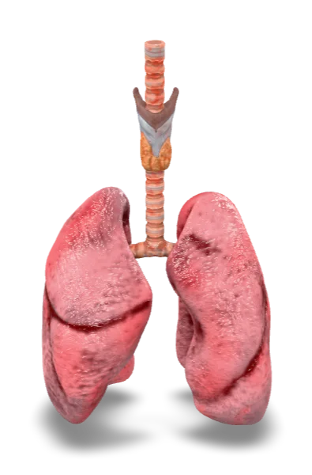
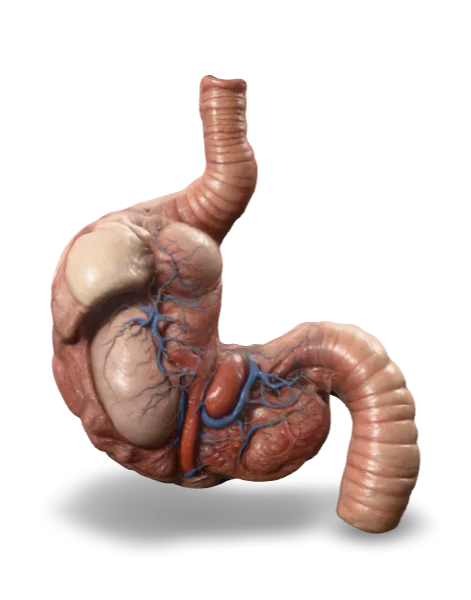
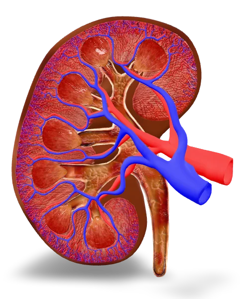
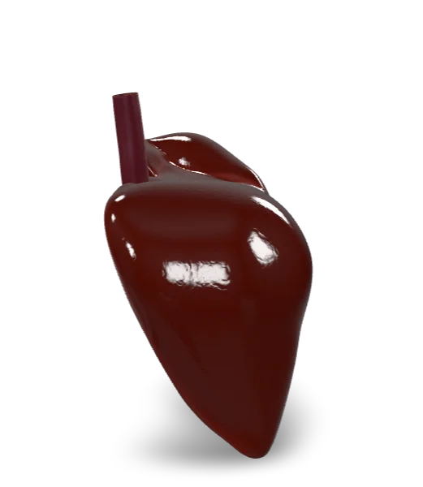

# AR Organ Tubuh

Web edukasi anatomi tubuh manusia berbasis **3D & Augmented Reality (AR)** tanpa instalasi aplikasi. Pengguna dapat memilih organ, memutar dan memperbesar model 3D, mengeksplorasi bagian-bagian organ melalui titik **hotspot interaktif**, mengikuti **kuis anatomi**, serta menampilkan organ langsung di ruangan nyata menggunakan kamera HP (**Lihat di AR**).

---

## 🌐 Demo Langsung

- **URL Produksi:** https://ar-ahf.pages.dev/
- **Scan QR Code** di bawah ini langsung dari kamera HP Android/iPhone untuk membuka demo:


---

## ✨ Fitur Utama

1. **Katalog 6 Organ Manusia MVP**
   - Jantung, Paru-paru, Otak, Lambung, Ginjal, dan Hati lengkap dengan deskripsi, daftar fungsi, dan fakta menarik (level SMP).
   - Pencarian organ *real-time* (case-insensitive) di halaman utama.
2. **Penampil 3D Interaktif (`<model-viewer>`)**
   - Putar 360°, *pinch/scroll zoom*, indikator loading saat model dimuat, dan *auto-rotate*.
3. **Markerless Augmented Reality (AR)**
   - Mendukung **WebXR** dan **Scene Viewer** di Android Chrome untuk meletakkan model organ di lantai atau meja melalui kamera HP tanpa kartu/marker tambahan.
4. **24 Titik Hotspot Anatomi Interaktif**
   - Masing-masing organ memiliki 4 titik hotspot akurat yang dapat diklik atau diakses dengan keyboard (`Tab` + `Enter`) untuk menampilkan penjelasan bagian organ.
5. **Kuis Interaktif & Skor Tertinggi**
   - Mode kuis seluruh organ (`quiz.html`) maupun per organ (`quiz.html?organ=<id>`).
   - Soal diacak dengan algoritma **Fisher-Yates**, umpan balik langsung + penjelasan, dan skor tertinggi tersimpan di `localStorage`.
6. **Dark Mode, Responsif & Ramah Aksesibilitas**
   - Dukungan tema Terang/Gelap otomatis mengikuti preferensi sistem (`prefers-color-scheme`) dengan tombol pengubah tema di header.

---

## 🖼️ Pratinjau Model Organ

| Jantung | Paru-paru | Otak |
| :---: | :---: | :---: |
|  |  |  |

| Lambung | Ginjal | Hati |
| :---: | :---: | :---: |
|  |  |  |

> *Catatan: Screenshot tampilan antarmuka tambahan dan rekaman GIF demo AR di HP dapat ditambahkan ke folder `img/` kapan saja.*

---

## 🛠️ Teknologi yang Digunakan

- **Frontend:** HTML5, CSS3 (CSS Custom Properties, Grid & Flexbox), Vanilla JavaScript (ES6+, tanpa framework & tanpa bundler)
- **3D & AR Engine:** [`<model-viewer>` v4.0.0](https://modelviewer.dev/) (via CDN)
- **Hosting & CDN:** Cloudflare Pages (HTTPS otomatis + aturan cache `_headers`)

---

## 💻 Cara Menjalankan Secara Lokal

> **Penting:** Jangan membuka file HTML langsung lewat protokol `file://` karena `<model-viewer>` membutuhkan server HTTP agar dapat memuat file `.glb`.

1. **Clone repository:**
   ```bash
   git clone https://github.com/MuhammadZidniirfan05-dot/AR.git
   cd AR
   ```
2. **Jalankan server statis** (pilih salah satu):
   - Menggunakan Node.js (`npx serve`):
     ```bash
     npx serve .
     ```
   - Menggunakan Python 3:
     ```bash
     python -m http.server 8000
     ```
   - Atau letakkan di folder web server lokal seperti **Laragon** (`http://localhost/AR/`) / **VS Code Live Server**.
3. Buka browser dan akses URL lokal yang tampil.

---

## 📂 Struktur Folder

```text
AR/
├── index.html            # Halaman utama daftar organ & pencarian
├── organ.html            # Halaman detail organ, 3D viewer, hotspot & AR
├── quiz.html             # Halaman kuis interaktif
├── 404.html              # Halaman tidak ditemukan
├── css/
│   └── style.css         # Styling responsif & variabel Dark Mode
├── js/
│   ├── data.js           # Data 6 organ, 24 hotspot, 12 soal kuis & tema
│   ├── app.js            # Logika daftar & pencarian organ
│   ├── viewer.js         # Logika 3D viewer, AR, hotspot & kredit
│   └── quiz.js           # Logika kuis Fisher-Yates & skor tertinggi
├── models/               # 6 aset 3D organ format .glb (< 5 MB per file)
├── img/                  # Poster organ (.webp), favicon (.svg) & QR code
├── _headers              # Aturan cache & keamanan Cloudflare Pages
├── NOTES.md              # Catatan kredit & verifikasi pengujian
└── README.md             # Dokumentasi proyek
```

---

## 🙏 Kredit Model 3D & Lisensi Aset

Seluruh model 3D telah dikompresi (maksimal 5 MB per file) dan digunakan sesuai ketentuan lisensi masing-masing kreator:

| Organ | Judul Model | Pembuat | Sumber | Lisensi |
| :--- | :--- | :--- | :--- | :--- |
| **Jantung** | Realistic Human Heart | neshallads | https://skfb.ly/oyBCT | CC-BY 4.0 |
| **Paru-paru** | Realistic Human Lungs | neshallads | https://skfb.ly/oBDWI | CC-BY 4.0 |
| **Otak** | Human Brain | AH | https://skfb.ly/oqZPW | CC-BY 4.0 |
| **Lambung** | Stomach - Organ | Trident.AI | [Sketchfab](https://sketchfab.com/3d-models/stomach-organ-56ffcd2330ae4b7ea6c7b8a08c82b4b7) | Sketchfab Free Standard |
| **Ginjal** | Kidney | cgmac | https://skfb.ly/6QUPW | CC-BY 4.0 |
| **Hati** | Human liver and gallbladder | ElliotSS | https://skfb.ly/6SD8p | CC-BY 4.0 |

---

## 📄 Lisensi Proyek

Kode sumber proyek ini dirilis di bawah lisensi **MIT**. Aset model 3D tetap mengikuti lisensi masing-masing kreator sebagaimana tercantum pada tabel kredit di atas.
